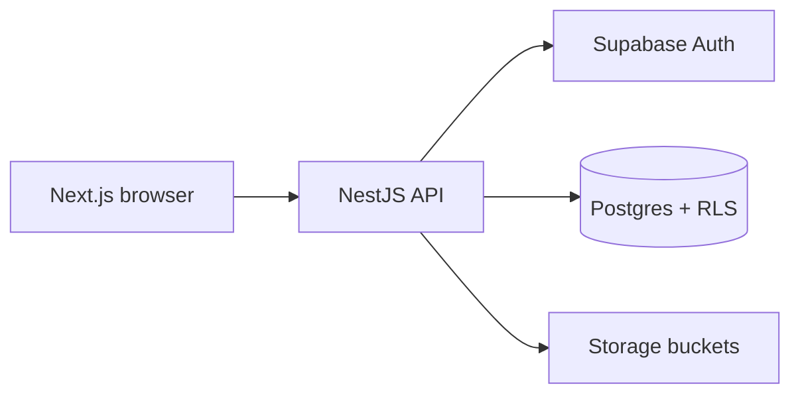
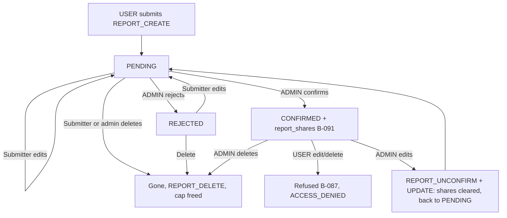
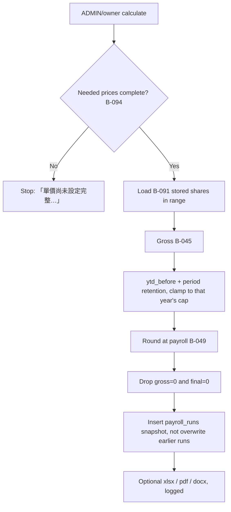
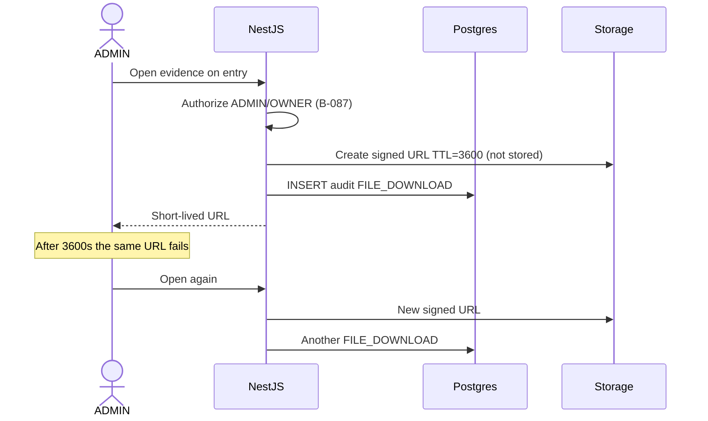
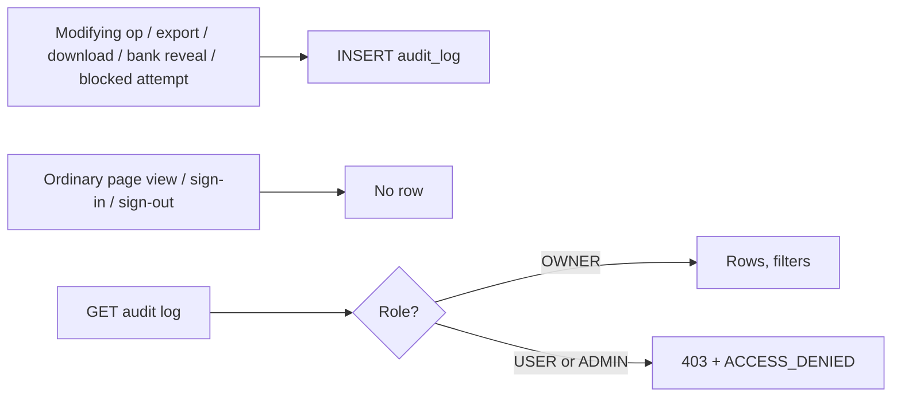

# Data flow / 資料流程

Source / 來源：`behavior-spec-final.md`. NestJS is the first authorization and validation line (B-006, B-087, B-088); Supabase RLS is the second. Provisional items tagged `PROVISIONAL(Q-0xx)`.

---

## 0. Runtime shape / 執行時形狀

**EN.** `apps/web` (Next.js) talks only to `apps/api` (NestJS). NestJS talks to Supabase Auth, Postgres, and Storage in the Asia region. The browser does not use the service role and does not mint its own signed URLs.

**ZH.** `apps/web`（Next.js）只呼叫 `apps/api`（NestJS）。NestJS 再存取位於亞洲區的 Supabase Auth、Postgres 與 Storage。瀏覽器不使用 service role，也不自行簽發下載連結。



---

## 1. Sign-in, session, lockout / 登入、工作階段、鎖定

Covers / 涵蓋：B-005, B-006, B-008, B-012, B-060, B-061, B-079, B-080, B-089, B-096, B-097. `PROVISIONAL(Q-052, Q-053, Q-058)`.

**EN.** Sign-in is type → display name → password (B-060). Types: `admin` (lists not-archived `ADMIN` plus the owner, `PROVISIONAL(Q-052)`), `west`, `south` (not-archived `USER` in that zone). Archived names are omitted. Already-signed-in visits to the sign-in page redirect to the landing page. Landing: `USER` → daily report; `ADMIN` and owner → confirmation (B-005). Sidebar: History, Materials, Settings for everyone; Audit only for the owner; `USER` also Daily report and Personal statistics; `ADMIN`/owner also Summary, Confirmation, Payroll, Ledger, Archives, Big-meter group; owner also Admin management.

**ZH.** 登入為類型 → 顯示名稱 → 密碼。`admin` 列出未封存的 `ADMIN` 與 owner（暫定 Q-052）；`west`/`south` 列出該區未封存 `USER`。已登入者再開登入頁會被送到落地頁。`USER` 進回報頁；`ADMIN` 與 owner 進確認頁。變動紀錄僅 owner 側欄可見；owner 另有管理員管理。

**Lockout (B-089) + rate limit (B-080):** failures count *per account*. 5 incorrect passwords → 15-minute lock, message 「密碼錯誤次數過多，請在 15 分鐘後再試」. Count resets on success, when the lock ends, or after 15 minutes with no further failure. A correct password before the fifth failure signs in and resets. Wrong/unknown/archived credentials show the same 「密碼錯誤，請重試」 (no account enumeration). The lock also applies to the owner (`PROVISIONAL(Q-053)`). Lockout writes `ACCOUNT_LOCKOUT` with a system actor; ordinary sign-in/sign-out are not logged (`PROVISIONAL(Q-058)`). Additionally, ≤ 10 attempts per client address per minute, shared across workers (B-080). Unauthenticated requests are redirected to sign-in and are not logged (`PROVISIONAL(Q-058)`, B-006).

**Session (B-061, B-079):** 30-minute idle timeout; user can also sign out. Saved data is kept. No remember-me (**Removed**). Cookies: HttpOnly, `SameSite=Lax` or stricter, Secure in production. State-changing requests are authenticated and CSRF-protected.

```mermaid
sequenceDiagram
  actor P as Person
  participant W as Next.js
  participant A as NestJS
  participant Auth as Supabase Auth
  participant DB as Postgres
  P->>W: Choose type, name, password
  W->>A: POST /auth/sign-in
  A->>DB: Rate limit by address (B-080)
  alt Over 10 / minute
    A-->>W: Refused
  end
  A->>DB: Load account by display name
  alt Archived, unknown, or locked
    A-->>W: 「密碼錯誤，請重試」 or lockout message
  else Password check
    A->>Auth: Verify password
    alt Wrong (count < 5)
      A->>DB: Increment failed_signin_count
      A-->>W: 「密碼錯誤，請重試」
    else Fifth failure
      A->>DB: lockout_until = now+15m; audit ACCOUNT_LOCKOUT (system)
      A-->>W: 「密碼錯誤次數過多，請在 15 分鐘後再試」
    else Correct and not locked
      A->>DB: Reset failure count
      A->>Auth: Create session (30 min idle)
      A-->>W: Set HttpOnly cookie; redirect by role (B-005)
    end
  end
```

---

## 2. Daily report submit / edit / delete / confirm / 日報送出、修改、刪除、確認

Covers / 涵蓋：B-020–B-025, B-038–B-044, B-058, B-062–B-064, B-069, B-071, B-086, B-087, B-088, B-091, B-097.

### 2.1 Submit / 送出 (B-062)

**EN.** Only a `USER` submits (self only). `ADMIN`/owner opening the report page are sent to the summary page; a direct create is refused (B-004, B-006, B-087). Date defaults to today, max 30 days back, no future (B-020). Quantities are multiples of 0.1, stored as integer 0.1-units (B-021). The form is not pre-filled; each submit is a new report, subject to the cap of 3 existing own submissions per date (B-025). Collaborators: up to 6, not-archived `USER`, same zone and big-meter flag, not self; invalid names dropped (B-022). Item set: west 32 / south 37 / big-meter 25; `bm_40_fen` never shown (B-038–B-040). Success: `REPORT_CREATE`, description includes 「共 N 人作業」 when collaborators exist. Error when a 4th own report exists: 「每日最多只能送出 3 筆回報」.

**ZH.** 僅 `USER` 可為自己送出。`ADMIN`/owner 開回報頁會被送到統計頁，直接新增亦拒絕。表單不預填；同一回報日期最多 3 筆仍存在的自己送出回報。協作者最多 6 人，須同區、同大表、未封存 `USER`。成功寫 `REPORT_CREATE`。

### 2.2 Edit / delete / 修改與刪除 (B-064)

| Actor | Pending | Rejected | Confirmed |
|---|---|---|---|
| Submitter `USER` | Edit (`REPORT_UPDATE`); delete (`REPORT_DELETE`, frees cap) | Edit clears rejected → pending; delete frees cap | Preview only; direct edit/delete refused (B-087) |
| Collaborator `USER` | View only 「共同作業回報，無法修改/刪除」 | Same | Same |
| `ADMIN` / owner | Edit / delete | Edit clears rejected → pending; delete | Edit clears confirmation (`REPORT_UNCONFIRM` + `REPORT_UPDATE`), drops official shares, returns to pending; delete allowed, cannot be undone |

**EN.** Editing from history is not a new submission and does not count toward the cap. Deletion cannot be undone. Confirm/reject are not undone on the confirmation page; the administrator edits or deletes in history (B-069).

**ZH.** 從歷史修改不算新送出、不佔額度。刪除無法復原。確認頁不能撤銷確認或駁回。

### 2.3 Confirm and B-091 shares / 核准與保存分配

**EN.** Ordinary confirmation (B-069) and big-meter confirmation (B-071) share behaviour; material requests are only on the ordinary confirmation page. Default range: last 30 days. Batch confirm/reject applies only to still-`PENDING` rows; others are skipped. On confirm: compute B-044 at the 0.1-unit layer (submitter first, then saved roster order; shares sum exactly to `Q`), persist `report_shares` (B-091), set reviewer and time, audit `REPORT_CONFIRM`. Later payroll/trial/summary/export of confirmed quantities must read stored shares, never re-split. Preview before approval uses the same formula but is not official. Custom item (B-024) is split the same way. Reject: `REPORT_REJECT`, excluded from payroll; submitter still sees the row in history.

**ZH.** 一般與大表確認行為相同；材料申請只在一般確認頁。批次只處理仍為待審的列。核准時依 B-044 計算並寫入 `report_shares`（B-091）。之後已核准只數一律讀已保存份額。核准前預覽公式相同但不正式。



---

## 3. Materials and B-091-style allocation (no double deduction) / 材料與不可重複扣庫存

Covers / 涵蓋：B-026–B-029, B-036, B-054–B-057, B-065, B-066, B-070, B-088. (Share persistence B-091 is on reports, §2; inventory has an analogous “once-only deduct” rule in B-056 / BDD-002.)

### 3.1 Employee request / 員工申請 (B-065, B-057)

**EN.** `USER` sees named tabs and non-hidden, non-quarantined items. Remaining colour: >5 green, 1–5 yellow, ≤0 red. Request is disabled and the server refuses when remaining is 0, hidden, or quarantined (「此材料目前不可申請」), or when quantity is outside 1–99, or when remaining < requested (「庫存不足，無法申請」). Success: status `PENDING`, `MATERIAL_REQUEST`. Cancel only own `PENDING` (removes the row, `MATERIAL_CANCEL`). `ADMIN`/owner cannot file a request (refused).

**ZH.** `USER` 只看未隱藏、非暫存材料。庫存 0、隱藏或暫存時畫面停用且伺服端拒絕。成功為待審。只能取消自己的待審申請。`ADMIN`/owner 不能申請。

### 3.2 Approve — no double deduction / 核准不得重複扣庫存 (B-056, B-070, BDD-002, BDD-003)

**EN.** Single and batch follow the same rules. Transaction: `SELECT material FOR UPDATE`; `UPDATE request WHERE id=? AND status='PENDING'`; if no row, refuse and do not touch inventory; if `remaining < quantity`, refuse with 「庫存不足，無法核准」, request stays `PENDING`, inventory unchanged; else `remaining -= qty`, `cumulative += qty`, `received` unchanged (invariant B-027), status `APPROVED`, `MATERIAL_APPROVE`. Reject: `REJECTED`, inventory unchanged, `MATERIAL_REJECT`. A second approve/reject on a non-`PENDING` request is refused (BDD-002).

**ZH.** 單筆與批次規則相同。交易內鎖材料列，並以 `status='PENDING'` 為更新條件。非待審再審必須拒絕且庫存不變。庫存不足拒絕並顯示「庫存不足，無法核准」。核准：庫存減、累計加、實領不變。駁回不改庫存。

```mermaid
sequenceDiagram
  participant A as NestJS
  participant R as material_requests
  participant M as materials
  A->>M: SELECT … FOR UPDATE
  A->>R: UPDATE … WHERE id AND status='PENDING'
  alt Not PENDING
    A-->>A: Refuse; inventory unchanged (BDD-002)
  else remaining < qty
    A-->>A: Refuse 「庫存不足，無法核准」; stay PENDING (BDD-003)
  else OK
    A->>M: remaining -= qty; cumulative += qty
    A->>R: status=APPROVED; MATERIAL_APPROVE
  end
```

### 3.3 Admin inventory / 管理員庫存 (B-066, B-054, B-055, B-036)

**EN.** Add / adjust (edit remaining and cumulative; received recalculated from B-027) / reorder / hide / move tab / delete (pending requests removed) / export Excel of all non-quarantined / import `.xlsx` or `.csv` with headers 「材料編號」「實領量」 / resolve quarantine (trust A or trust B, B-055) / reset (irreversible prompt; default catalogue; quantities 0; flags cleared; tab 1; label cleared). Import comparison is B-054 (`x = B.received - A.received`; quarantine if `x<0`, A inconsistent, or B ≠ expected A-after-update). Audit: `MATERIAL_*`, `MATERIAL_KEEP_A`, `MATERIAL_SYNC_B`, `MATERIAL_RESET`, `MATERIAL_IMPORT`.

**ZH.** 管理員可增刪改、調整庫存與累計（實領由不變式重算）、匯入比對（B-054）、暫存區解決（B-055）、重置（不可逆確認）。

---

## 4. Payroll and retention cap / 計薪與保留金上限

Covers / 涵蓋：B-015–B-019, B-032–B-035, B-041–B-053, B-059, B-068, B-072, B-081, B-090, B-091, B-092, B-094, B-097. `PROVISIONAL(Q-054, Q-057, Q-060)`.

**EN.** `ADMIN`/owner enter a range (or B-059 shortcuts: 10號 = last month 21st–this month 5th and check 10th-payday; 25號 = this month 6th–20th and uncheck). If any needed unit price is missing, stop with 「單價尚未設定完整，無法計算薪資，請先補齊單價」 (B-094). Otherwise, for each included account:

1. Confirmed reports in the inclusive range, using **stored shares only** (B-091).
2. `gross = Σ(share × unit price of that person's set) + custom-item money` (B-045). Price set from zone + big-meter. Do not round money here.
3. Include `ADMIN` and owner (`PROVISIONAL(Q-054)`) if they have confirmed reports or positive fixed salary. Role used is the role at calculation time (`PROVISIONAL(Q-057)`).
4. Archived accounts: include reports confirmed before archive, and reports submitted before archive and approved after, with name marked 「封存」. Archive-period (range contains archive date): fixed salary still counted; admin may manually adjust (B-017, Q-040). Later periods while still archived: fixed salary default not counted; admin may add back (Q-041).
5. Retention (ordinary `USER` only; big-meter / `ADMIN` / owner = 0, B-043, `PROVISIONAL(Q-054)`): `ytd_before` from 1 Jan of that year up to (not including) period start, plus that year's offset, clamped to `[0, cap_for_that_year]` (B-046, B-035, `PROVISIONAL(Q-060)`). `period_retention = max(0, min(period_raw, cap - ytd_before))` (B-047).
6. `net = gross - period_retention`; `final = net + fixed_applied - insurance_applied - uninsured` (B-049). Fixed applies if 10th-payday or “every period”. Insurance applies if 10th-payday and deduction > 0. Uninsured does not depend on the 10th flag: 0 if enrolled or exempt, else override or zone rate × **gross only**, rounded at payroll (B-050, B-092).
7. Round money to whole NTD (half-up) only at this step. Drop rows with `gross==0` and `final==0` (B-051). Cash denomination greedy 1000…1 (B-053). Bank last-four by default; full number only after logged reveal; transfer-form export blocked if the key is missing (B-014, B-081).

**Cap change (B-035):** admin or owner, integer ≥ 0, logged `SYSTEM_CONFIG` with old and new values. Applies from the current calendar year; already calculated / exported / archived results stay (new calculation of a current-year period after the change uses the new cap; a previous-year period uses that year's stored cap, `PROVISIONAL(Q-060)`). Cap 0 means no retention; if the new cap is below already-retained this year, later period retention is 0, displayed YTD is clamped, no automatic refund.

**Year-end (B-090):** one action closes a chosen year for all accounts, records refunded amounts only (`RETENTION_YEAR_END`); payment is outside the system. 1 Jan 00:00 Taiwan still resets displayed YTD to 0 even if settlement was not run (B-048).

**Exports (B-072, B-084):** one `.xlsx` (summary sheet first, then one detail sheet per person); `.pdf` A4 landscape; Word `.docx` 板信商業銀行 slip for `TRANSFER` and `final>0` only. No full-page loading overlay (B-086). Each export is logged (B-097).

**USER trial (B-068):** own data, all official components, user chooses whether the trial is a 10th payday; uses current prices; official pay is always the administrator run. `ADMIN`/owner opening this page go to the summary.



---

## 5. Petty cash, ledger, evidence files / 零用金、流水帳、證據檔

Covers / 涵蓋：B-030, B-031, B-076, B-084, B-085, B-098. `PROVISIONAL(Q-061, Q-062)`.

**EN.** `ADMIN`/owner only. Filter by date, type, category; 20 rows per page. Income/expense totals follow the current filter. 零用金餘額 is cumulative from the beginning through the filter end date (inclusive); if no date filter, through today Taiwan (B-076, BDD-008). Voided entries stay listed as 「作廢」, are excluded from both totals and the balance, cannot be edited / settled / un-voided in v0, and appear in Excel marked 「作廢」 (`PROVISIONAL(Q-061)`). Any entry may be voided (`LEDGER_VOID`). Delete is allowed only if the entry has *never* had an evidence file (`LEDGER_DELETE`); otherwise 「此紀錄有證據檔案，不能刪除，只能作廢」 (B-098). Settle (B-031): expense with an employee payer → clear payer to company; if already company, say so and make no change; voided cannot be settled.

**Files (B-085, Q-051, `PROVISIONAL(Q-062)`):** one current file per entry; replace keeps earlier versions, both openable; cannot remove a file. Permanent retention. Each open: NestJS creates a **new** 3,600-second signed URL, writes `FILE_DOWNLOAD`, and does not store the URL. Expired links fail; opening again mints a new one. Works for entries older than 30 days and for voided entries. If storage is not configured, the entry still saves and the user is warned.

**ZH.** 僅 `ADMIN`/owner。篩選範圍內算收支合計；零用金餘額從開始累計到篩選結束日（無篩選則至今天）。作廢列仍顯示但不計入合計與餘額。有（或曾有）證據檔者不能刪、只能作廢。每次點開都新簽 3,600 秒連結並寫 `FILE_DOWNLOAD`，不保存該連結。



---

## 6. Archives / 日月報檔案庫

Covers / 涵蓋：B-077, B-078, B-085, B-097.

**EN.** Daily job at 23:59 Taiwan: confirmed reports of that day, skipped if an automatic daily archive for that date already exists. Monthly job at 23:59 on the last calendar day: 1st through that day, including a payroll-summary sheet, skipped if automatic monthly already exists. At most one automatic archive per (type, date) across restarts and workers (B-078). Manual generate does not replace earlier automatic or manual copies (suffix). Manual monthly covers 1st through the chosen date (intended). Files: Excel (three sheets 西區 / 南區 / 大表) and PDF when produced. Download: new 1-hour link, logged. Deleting an archive record removes its stored files (not evidence files). Pagination 30. If storage is missing, the record exists and download warns.

**ZH.** 每日/每月 23:59（台灣時間）自動生成，同一類型與日期最多一份自動歸檔。手動生成不取代既有檔（加後綴）。手動月報為 1 日至所選日。下載為 1 小時新連結並留紀錄。刪歸檔紀錄會刪檔案（與證據檔不同）。

---

## 7. Reports and exports / 報表與匯出

Covers / 涵蓋：B-063, B-068, B-072, B-073, B-076, B-084, B-086, B-093, B-097.

| Export | Who | Content | Log |
|---|---|---|---|
| History Excel | `USER` (visible rows) / `ADMIN`/owner (page filters) | Ordinary: union of west+south items + custom + confirmation. Big-meter: big-meter items. `.xlsx` | `EXPORT` |
| Materials Excel | `ADMIN`/owner | All non-quarantined: tab, code, name, spec, unit, cumulative, received, remaining, hidden | `EXPORT` |
| Ledger Excel | `ADMIN`/owner | Filtered rows, including voided marked 「作廢」 (`PROVISIONAL(Q-061)`) | `EXPORT` |
| Summary Excel/PDF | `ADMIN`/owner | Per-person credited quantities (stored shares if confirmed); ordinary and big-meter are separate pages (B-073) | `EXPORT` |
| Payroll xlsx/pdf/docx | `ADMIN`/owner | See §4. Transfer form blocked if bank key missing | `EXPORT` |
| Evidence / archive file | `ADMIN`/owner (audit view N/A) | Short-lived URL | `FILE_DOWNLOAD` |

**EN.** Exports and downloads must not use a full-page wait (B-086). Ordinary page views are not logged (B-097). Traditional Chinese must render correctly (B-084).

**ZH.** 匯出/下載不得使用全頁等待。一般查看不記錄。繁體中文須正確顯示。

---

## 8. Audit log / 變動紀錄

Covers / 涵蓋：B-037, B-067, B-083, B-093, B-097. `PROVISIONAL(Q-058, Q-059)`.

**EN.** Written for all modifying operations, exports and downloads (including each evidence/archive open), full bank-number views (`BANK_REVEAL`), and blocked unauthorized attempts (`ACCESS_DENIED`), by anyone including the owner. Not written for ordinary viewing, or for ordinary sign-in/sign-out, or for unauthenticated requests (`PROVISIONAL(Q-058)`). Only the owner can open the log; `USER`/`ADMIN` have no sidebar entry, the request is forbidden (B-006), and the blocked attempt is logged. Rows cannot be edited or deleted by anyone, including the owner (`PROVISIONAL(Q-059)`). Pagination 20; filter by actor, type, date range.

**ZH.** 所有修改、匯出與下載、查看完整銀行帳號、被擋下的越權操作都留紀錄（含 owner）。一般查看、一般登入登出、未登入請求不記錄。只有 owner 能看；`USER`/`ADMIN` 禁止並留下 `ACCESS_DENIED`。任何人不能改或刪紀錄。



---

## 9. Account lifecycle and owner flows / 帳戶生命週期與 owner 流程

Covers / 涵蓋：B-003, B-004, B-008, B-012, B-074, B-093, B-095, B-096, B-097. `PROVISIONAL(Q-052–Q-057)`.

See `permission-matrix.md` for the full matrix. Short flow: `ADMIN` manages `USER` only (`PROVISIONAL(Q-056)`). Owner uses Admin management for `ADMIN` add/archive/restore/modify and for `USER`↔`ADMIN` switches (big-meter must be off first, `PROVISIONAL(Q-057)`; existing reports unchanged; payroll uses role at calc time). Owner cannot be archived; `ADMIN` cannot archive self or other admins. Password: self-change needs current password; `ADMIN` may reset a `USER` password without it; resetting an `ADMIN` password is owner-only. Reveal full bank: last four default; reveal writes `BANK_REVEAL`; missing key → 「無法讀取」 and block export/edit (B-093, B-081).

**ZH.** `ADMIN` 只管理 `USER`。owner 在管理員管理頁管理 `ADMIN` 與角色切換。owner 不能封存；`ADMIN` 不能封存自己或其他 admin。點看完整銀行帳號寫 `BANK_REVEAL`；金鑰缺失 fail closed。

---

## 10. B-rules covered in this document / 本文件涵蓋的 B 規則

B-003, B-004, B-005, B-006, B-008, B-012, B-014, B-015, B-016, B-017, B-018, B-019, B-020, B-021, B-022, B-023, B-024, B-025, B-026, B-027, B-028, B-029, B-030, B-031, B-032, B-033, B-034, B-035, B-036, B-037, B-038, B-039, B-040, B-041, B-042, B-043, B-044, B-045, B-046, B-047, B-048, B-049, B-050, B-051, B-053, B-054, B-055, B-056, B-057, B-058, B-059, B-060, B-061, B-062, B-063, B-064, B-065, B-066, B-067, B-068, B-069, B-070, B-071, B-072, B-073, B-074, B-076, B-077, B-078, B-079, B-080, B-081, B-083, B-084, B-085, B-086, B-087, B-088, B-089, B-090, B-091, B-092, B-093, B-094, B-095, B-096, B-097, B-098.

